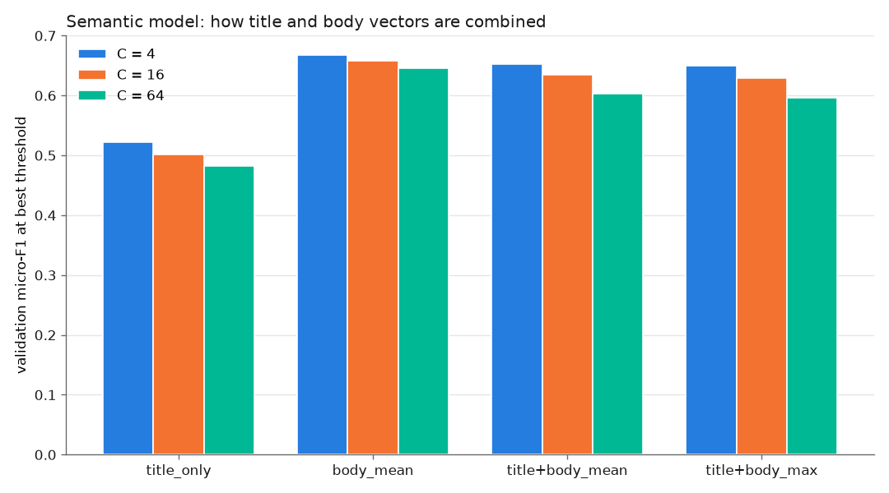
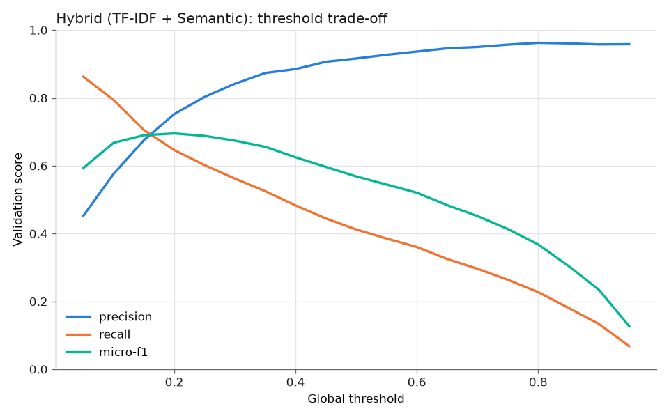
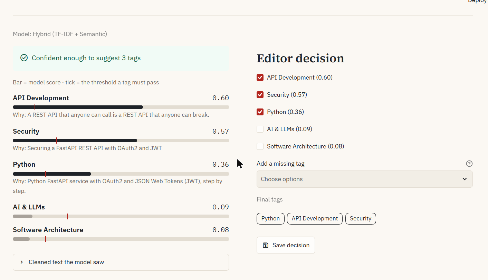
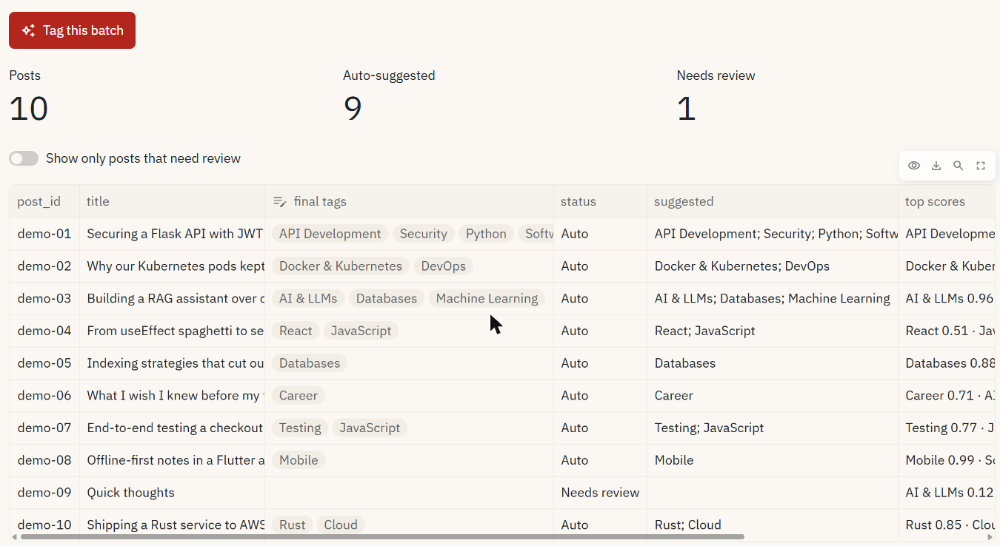

## Summary

Blog archives get harder to search when authors tag the same topic in different ways or leave posts
untagged. This project builds a multi-label system that reads a post's title and body (plain text,
Markdown or HTML), suggests up to five tags from a 22-tag approved taxonomy with a score for each, and
routes a post to an editor when it is empty, too short, or no tag is confident enough. Editors accept,
remove or add approved tags in a Streamlit app; their decisions are saved as feedback and can be
exported for a whole batch as CSV or JSON.

On the newest 705 posts, held out by date, the **Hybrid (TF-IDF + semantic)** model reaches micro-F1 **0.719** (macro-F1 0.651, P@3 0.538, R@3 0.828), tags 97.3% of posts without review and needs about 173 ms per post, against 0.600 for the keyword baseline. TF-IDF alone is almost as good (0.714) and 16× faster, so it is recommended for bulk tagging. A 40-post audit shows the authors' own tags are incomplete: measured against audited labels, precision rises from 0.704 to 0.765.

| Deliverable | Where |
|---|---|
| Taxonomy, definitions, examples and alias map | `taxonomy/taxonomy.yaml` |
| Reproducible data preparation (dataset not redistributed) | `scripts/01_download_devto.py`, `scripts/02_prepare_data.py`, `data/article_ids.csv` |
| Training and evaluation code: keyword, TF-IDF, semantic | `tagger/models/`, `scripts/03_train.py` to `scripts/06_audit.py` |
| Working demo with CSV/JSON export | https://blog-auto-tagger.streamlit.app · `streamlit_app.py` |
| Source code | https://github.com/Vkun2508/blog-auto-tagger |

## 1. Data

**Source.** 4,705 posts from the public DEV.to API (no key, no payment), published between
14 November 2025 and 14 November 2026. Posts were collected as the most popular posts of the past year for 29 seed tags,
two pages each, at about one request per second with every post cached to disk so the download
can resume. Each post keeps its title, Markdown body, the author's tags, publication date and URL.

**Copyright.** Article text belongs to its authors, so it is not redistributed. The repository
contains the download script and `data/article_ids.csv`, which lists every post used; running
the commands in the README rebuilds the same dataset.

**Labels.** The labels are the authors' own tags, mapped onto the approved taxonomy. DEV.to allows
at most four tags per post, and authors often spend slots on generic tags, so labels are
incomplete. Section 7 measures how much this matters.

## 2. Taxonomy and alias map

The taxonomy (`taxonomy/taxonomy.yaml`) has **22 approved tags**. Each tag has a definition, two
example titles, **aliases** (raw author tags that merge into it) and **keywords** for the baseline
model. The alias map merges variants into one editorial tag, for example:

| Raw author tags | Approved tag |
|---|---|
| `ml`, `machinelearning`, `deeplearning`, `pytorch`, `mlops` | Machine Learning |
| `ai`, `llm`, `agents`, `rag`, `mcp`, `openai`, `claude` | AI & LLMs |
| `security`, `cybersecurity`, `infosec`, `appsec`, `owasp` | Security |
| `docker`, `kubernetes`, `k8s`, `containers`, `helm` | Docker & Kubernetes |
| `react`, `nextjs`, `redux` | React |

Each alias belongs to exactly one tag (checked by a test). Tags that describe format or are used on
posts about everything (`programming`, `beginners`, `tutorial`, `discuss`, `webdev`, `opensource`,
`productivity` and others) are listed under `dropped_generic` and not mapped. Generic tags are common: 62.4% of posts (2,936 of 4,705) used at least one of their four tag slots on one, led by `webdev` (828 posts), `programming` (688) and `opensource` (500).
Keywords written in capitals (`AI`, `Rust`, `in Go`) match case-sensitively, so ordinary words
like "said", "rust" or "go to" do not trigger a tag.

**Tag counts.** After mapping, every post has at least one approved tag (1.91 on average: 1,501 posts have one, 2,256 two, 831 three and 117 four). The largest tag is AI & LLMs (1,541 posts) and the smallest Frontend (145). Tags are flagged as too few for reliable evaluation when they have fewer than 20 test posts or 80 in total: only **Data Science** is flagged, with 10 test and 12 validation posts, because few recent posts use it. Its test scores should be read with care.


*Posts per approved tag in each split (`reports/tag_counts.csv`).*

## 3. Cleaning, duplicates and the split

**Cleaning** (`tagger/cleaning.py`) detects whether the input is HTML, Markdown or plain text.
HTML navigation, headers, footers, sidebars, forms, scripts and buttons are removed with
BeautifulSoup. DEV.to liquid embeds, images, bare URLs and Markdown syntax are removed while link
text is kept. Short boilerplate lines ("follow me", "subscribe", "originally published at",
"thanks for reading"), lines that only list social sites, and **tag-widget lines** such as
`#python #ai` are dropped, because those would hand the label to the model. Code blocks keep
their language name and first 30 lines: code carries topic signal, but long listings drown out
the prose. A YAML front-matter block at the top of a post (`title:`, `published:`, `cover_image:`, `series:` …),
present in 654 posts, is removed as template text. Titles are only whitespace-normalised.

**Duplicates.** Before splitting, posts are joined into groups when they share a normalised title,
the same original (canonical) URL, or have TF-IDF cosine similarity of 0.90 or more. This found 12 groups containing 29 posts (16 links by identical title, 12 by near-identical body, none by canonical URL), mostly the same article posted twice by its author, sometimes in a second language.
A group always stays in one split, so a republished copy cannot leak from training into test.

**Split by date.** Groups are ordered by their earliest publication date. The oldest 70% of posts
form the training set, the next 15% the validation set and the newest 15% the test set, which
approximates how the system will meet new drafts.

| Split | Posts | Share | Published |
|---|---|---|---|
| Train | 3,294 | 70.0% | 14 Nov 2025 – 9 Jun 2026 |
| Validation | 706 | 15.0% | 9 Jun 2026 – 7 Sep 2026 |
| Test | 705 | 15.0% | 4 Sep 2026 – 14 Nov 2026 |

The boundaries overlap by a few days because whole duplicate groups are placed by their earliest post.

## 4. Models

All models share one interface: given titles and bodies, return a score between 0 and 1 for each
of the 22 tags. The same suggestion logic (`tagger/suggest.py`) is then applied to every model.

1. **Keyword baseline.** For each tag, count taxonomy keyword matches: each distinct keyword in the
   title counts 3, each occurrence in the body counts 1 (capped at 10), and the total *h* becomes
   a score of 1 − e^(−h/4). No training.
2. **TF-IDF + one-vs-rest logistic regression.** Separate TF-IDF vectorisers for the title
   (20k features) and the body (50k features), unigrams and bigrams, sublinear term frequency.
   The title block is multiplied by a **title weight**; one logistic regression per tag is trained
   on the combined features.
3. **Semantic model.** The pretrained sentence embedding model `all-MiniLM-L6-v2` (Sentence
   Transformers, 384 dimensions) encodes the title and the body. The body is split into chunks
   of about 150 words; long posts keep at most 8 chunks spread evenly from start to end, so a long
   article is represented across its whole length. Chunk vectors are combined by pooling (compared
   below), and one logistic regression per tag is trained on the result.
4. **Hybrid.** A weighted average of the TF-IDF and semantic scores.

### Validation experiments

Every choice below was made on the validation set; the test set was not used until Section 6.

**Does giving the title extra weight help TF-IDF?** Title weights ×0 (title ignored) to ×3 were tried with
C ∈ {4, 16, 64}. Because models with different C put scores on different scales, each configuration is compared
at its own best threshold and tag limit on validation (the same search used in Section 5); the micro-F1 at a fixed
0.5 threshold is shown only for reference.

| Title weight | Best C | Micro-F1 (best threshold) | Macro-F1 | P@3 | Micro-F1 at 0.5 |
|---|---|---|---|---|---|
| ×0 | C = 16 | 0.688 | 0.588 | 0.508 | 0.565 |
| ×1 | C = 64 | 0.682 | 0.593 | 0.493 | 0.588 |
| ×2 | C = 4 | 0.613 | 0.506 | 0.442 | 0.515 |
| ×3 | C = 4 | 0.565 | 0.459 | 0.406 | 0.513 |

Weights ×0 and ×1 are practically tied (0.688 vs 0.682), and extra weight hurts (×3: 0.565). Titles on
DEV.to are often written to attract clicks ("I got rejected 2 minutes after applying") rather than to describe the
topic, while the body names the technologies. The chosen configuration is title weight ×0
with C = 16.


*TF-IDF validation micro-F1 by title weight and regularisation C.*

**How chunk representations are combined.** Each body chunk is encoded separately; the chunk vectors
are then combined by averaging each dimension (mean) or taking its largest value (max), optionally joined
(⊕, concatenation) with the title vector.

| Pooling | Best C | Micro-F1 (best threshold) | Macro-F1 | P@3 |
|---|---|---|---|---|
| Title only | C = 4 | 0.522 | 0.432 | 0.383 |
| Mean of body chunks | C = 4 | 0.667 | 0.569 | 0.484 |
| Title ⊕ mean of chunks | C = 4 | 0.652 | 0.567 | 0.482 |
| Title ⊕ max of chunks | C = 4 | 0.650 | 0.557 | 0.477 |

The mean of the body chunks works best (0.667, C = 4): averaging
smooths over sections that wander off-topic, while adding the title vector or taking the maximum adds noise. The title
alone is clearly weaker (0.522), in line with the TF-IDF
result.


*Semantic model validation micro-F1 by chunk pooling.*

**Hybrid.** Weights of 0.3, 0.5 and 0.7 for TF-IDF were tried; 0.7 TF-IDF and 0.3 semantic scored best (0.695), above either model alone (TF-IDF 0.688, semantic 0.667). The two models make different mistakes: TF-IDF keys on exact technology names, the encoder on overall meaning.

## 5. Thresholds and the review workflow

Each model's scores become suggestions with two settings chosen on validation: a **score
threshold** (0.05 to 0.95 in steps of 0.05) and a **maximum number of tags** (1 to 5), keeping the
pair with the best micro-F1. Tags with at least 20 validation examples were also given their own
threshold; per-tag thresholds were kept only where they raised validation micro-F1.

A post is **routed to review** when it is empty, has fewer than 30 words after cleaning, or no tag
passes its threshold. The editor always sees the top five candidates with their scores, even when
none passes.

| Model | Threshold | Max tags | Val micro-F1 (global) | Tags with own threshold | Val micro-F1 (per-tag) |
|---|---|---|---|---|---|
| Keyword baseline | 0.40 | 2 | 0.555 | 21 | 0.616 |
| TF-IDF + logistic regression | 0.15 | 5 | 0.688 | 21 | 0.703 |
| Semantic (MiniLM) | 0.25 | 4 | 0.667 | 21 | 0.678 |
| Hybrid (TF-IDF + semantic) | 0.20 | 4 | 0.695 | 21 | 0.723 |

The trade-off for the default model (Hybrid (TF-IDF + semantic), up to 4 tags) on validation:

| Threshold | Precision | Recall | Micro-F1 | Wrong tags / post | Missed tags / post | Sent to review |
|---|---|---|---|---|---|---|
| 0.10 | 0.576 | 0.794 | 0.668 | 1.12 | 0.40 | 0.6% |
| 0.20 (chosen) | 0.752 | 0.646 | 0.695 | 0.41 | 0.68 | 6.1% |
| 0.35 | 0.874 | 0.525 | 0.656 | 0.15 | 0.91 | 15.4% |
| 0.50 | 0.916 | 0.412 | 0.569 | 0.07 | 1.13 | 28.2% |
| 0.70 | 0.950 | 0.296 | 0.452 | 0.03 | 1.35 | 45.9% |

Raising the threshold removes wrong suggestions quickly but misses more tags and sends more posts to an editor.
The chosen global threshold sits where F1 peaks. The per-tag thresholds of the hybrid then range from 0.05 (Machine
Learning, Java, Testing) to 0.30 (Rust); 14 of the 21 tags with their own threshold use a lower bar than the global
0.20, because their correct scores are often modest, and five (React, AI & LLMs, Cloud, Git, Rust) a higher one. Per-tag thresholds were tuned and measured on the same validation
posts, so their validation gain is optimistic; the test results below are the unbiased check.


*Precision, recall and F1 of the default model on validation as the threshold changes.*


*Share of validation posts routed to review at each threshold, per model.*

## 6. Results on unseen posts

All models were evaluated once, with their tuned settings, on the test set (the newest 15% of
posts, never seen in training or tuning). Micro-F1 pools every tag decision; macro-F1 averages
per-tag F1 so rare tags count equally; P@3 and R@3 look only at the top three ranked tags; review
coverage is the share of posts tagged without an editor; speed is the median time to tag one post,
including cleaning, on a laptop CPU.

| Model | Precision | Recall | Micro-F1 | Macro-F1 | P@3 | R@3 | Auto-tagged | ms / post |
|---|---|---|---|---|---|---|---|---|
| Keyword baseline | 0.649 | 0.558 | 0.600 | 0.520 | 0.435 | 0.687 | 95.2% | 16 |
| TF-IDF + logistic regression | 0.679 | 0.753 | 0.714 | 0.649 | 0.532 | 0.821 | 98.2% | 11 |
| Semantic (MiniLM) | 0.663 | 0.689 | 0.675 | 0.612 | 0.525 | 0.809 | 96.7% | 162 |
| **Hybrid (TF-IDF + semantic)** | 0.701 | 0.740 | 0.719 | 0.651 | 0.538 | 0.828 | 97.3% | 173 |


*Test-set comparison of the four models.*

**Which model balances quality, coverage and speed best?** All learned models beat the keyword
baseline by a wide margin (micro-F1 0.600). The **Hybrid (TF-IDF + semantic)** model, chosen on validation
before the test set was opened, is also the best on test: micro-F1
0.719, macro-F1 0.651, P@3 0.538, R@3 0.828, with 97.3% of
posts tagged without review, at about 173 ms per post including cleaning. TF-IDF alone is within
0.005 micro-F1 and 16× faster (11 ms).

The recommendation is therefore split by use: **the hybrid for the editor-facing app**, where 0.2 seconds is
unnoticeable and its better handling of short drafts (below) matters, and **TF-IDF for bulk re-tagging of an
archive**, where speed matters and quality is nearly the same. The semantic model on its own is slower than TF-IDF
and less accurate, but it adds complementary signal to the hybrid.

### By tag frequency

Tags were split into thirds by how many training posts they have.

| Model | Common | Medium | Rare |
|---|---|---|---|
| Keyword baseline | 0.624 | 0.425 | 0.497 |
| TF-IDF + logistic regression | 0.748 | 0.545 | 0.640 |
| Semantic (MiniLM) | 0.703 | 0.534 | 0.586 |
| Hybrid (TF-IDF + semantic) | 0.753 | 0.566 | 0.619 |

Common: Python; Security; AI & LLMs; DevOps; Docker & Kubernetes; Cloud; Databases; Mobile. Medium: JavaScript; React; API Development; Machine Learning; Data Science; Software Architecture; Git. Rare: TypeScript; Frontend; Java; Go; Rust; Testing; Career.

Common tags are easiest for every model. Frequency is not the whole story, though: the **medium** third is hardest, because it holds broad, overlapping tags. The weakest tags for Hybrid (TF-IDF + semantic) are Software Architecture (0.37), Go (0.47), API Development (0.50), Rust (0.52), while distinctive tags score high even with fewer examples: AI & LLMs (0.90), Java (0.86), Docker & Kubernetes (0.85), Mobile (0.84). Data Science has only 10 test posts, so its score is unreliable (flagged in Section 2). Per-tag results are in `reports/test_per_tag.csv`.

### Short drafts

To imitate early drafts, each test post was cut to its title plus the first 40 or 10 words of the
body.

| Model | Full post | Title + 40 words | Sent to review | Title + 10 words | Sent to review |
|---|---|---|---|---|---|
| Keyword baseline | 0.600 | 0.377 | 52.1% | 0.320 | 98.0% |
| TF-IDF + logistic regression | 0.714 | 0.506 | 23.0% | 0.357 | 98.0% |
| Semantic (MiniLM) | 0.675 | 0.509 | 4.1% | 0.363 | 97.6% |
| Hybrid (TF-IDF + semantic) | 0.719 | 0.540 | 8.7% | 0.377 | 97.6% |

Quality falls as drafts get shorter. At 10 words almost every draft is routed to review by the 30-word rule, which is the intended behaviour. At 40 words, Hybrid (TF-IDF + semantic) keeps the most quality (0.540) while sending only 8.7% to review, against 23.0% for TF-IDF: the encoder still recognises the topic from a few sentences. Empty drafts are never scored and always go to review.

## 7. Errors and incomplete labels

Examples come from `reports/error_examples.md` (titles and links only).

**False positives and missed tags.** The five most confident wrong suggestions on test:

| Score | Suggested tag | Post | True tags |
|---|---|---|---|
| 0.981 | Databases | [Update DB Schema in Production with Flyway like Syntax](https://dev.to/codenameone/update-db-schema-in-production-with-flyway-like-syntax-2lj6) | Java, Mobile |
| 0.963 | Data Science | [Data Engineering Basics for Developers: Pipelines, Warehouses, and Streaming](https://dev.to/apeder/data-engineering-basics-for-developers-pipelines-warehouses-and-streaming-3b1m) | Databases, Software Architecture |
| 0.946 | AI & LLMs | [I Put a Local LLM in Charge of a Colony and Asked It to Tell the Truth. It Didn't.](https://dev.to/mikachu/i-built-a-text-based-survival-game-to-test-ai-morals-the-honest-one-lost-3fan) | Machine Learning, Python |
| 0.939 | AI & LLMs | [I built a Python script that generates writing and coding prompts for my 30-day writing challenge](https://dev.to/rupaligauravaram/i-built-a-python-script-that-generates-writing-and-coding-prompts-for-my-30-day-writing-challenge-36e4) | Data Science, Python |
| 0.933 | AI & LLMs | [The Rootkit Exorcist: Summoning Local AI to Investigate Suspicious Scripts 👻](https://dev.to/data_secchronicles/the-rootkit-exorcist-summoning-local-ai-to-investigate-suspicious-scripts-an1) | Security |

Most of these are arguably *correct* tags the author did not add: a post about database schema migrations
suggested as Databases, a data-engineering primer as Data Science, two posts about running local LLMs as AI & LLMs.
The most-missed tags are broad ones:

| Tag | Missed | Test posts | Miss rate |
|---|---|---|---|
| DevOps | 55 | 131 | 0.420 |
| Cloud | 30 | 63 | 0.476 |
| Software Architecture | 28 | 40 | 0.700 |
| AI & LLMs | 26 | 314 | 0.083 |
| Testing | 25 | 72 | 0.347 |

DevOps, Cloud and Software Architecture describe a *context* (where the code runs, how it is organised) more than a
technology, so their wording varies widely between posts.

**Similar tags.** The most frequent confusions for Hybrid (TF-IDF + semantic): Machine Learning suggested for AI & LLMs posts (50); JavaScript suggested for TypeScript posts (12); JavaScript suggested for React posts (8); TypeScript suggested for JavaScript posts (8).
Machine Learning vs AI & LLMs is the largest: many posts about LLM agents use ML vocabulary (training, models,
evaluation), and the boundary in the taxonomy (training predictive models vs using LLM products) is a fine one.
JavaScript, TypeScript and React overlap in the same way.

**Short drafts.** 145 test posts were tagged exactly right from the full text but wrongly from the title and first 40
words, e.g. *Dealing with sensitive permissions on Android* (Mobile, Security) became AI & LLMs. This is why drafts
under 30 words are routed to review.

**Niche topics.** Rare-tag misses cluster where a niche tag is implied rather than named, e.g. *Learn Trapping Rain
Water… in DSA View* (true: TypeScript) was suggested JavaScript, and *I sent 17 pull requests…* (true: Git, Career)
lost Career.

**Long multi-topic posts.** Long posts were not a major weakness: among the longest 10% of posts with three or more
tags, the model often finds every tag (e.g. *Stop rebuilding from scratch: cache Docker layers on Cloud Build*: all four
found). When it fails, it usually drops a secondary topic, because averaged chunk vectors and length-normalised TF-IDF
both favour the dominant one. A
Flutter post labelled React through the author tag `statemanagement` also exposed an alias-map error, which was
fixed (the alias now sits in `dropped_generic`).

### The effect of incomplete historical labels

A reviewer checked 40 randomly chosen test posts (seed 42), reading each post and marking approved tags
that were **missing** from the author's labels or **wrong** for the post (first pass AI-assisted, then confirmed by
Vinochan R; the reviewer could see the model's suggestions, which is how an editor would work but may bias towards
agreeing with them). The sheet is `reports/audit/audit_sample.csv`; scoring is `scripts/06_audit.py --score`.

| Hybrid (TF-IDF + semantic) measured against | Precision | Recall | F1 |
|---|---|---|---|
| Authors' original tags | 0.704 | 0.750 | 0.726 |
| Audited tags | 0.765 | 0.765 | 0.765 |

7 of 40 posts were missing at least one correct approved tag, and 5 of the model's 24 "false positives"
(21%) were judged correct. A few author tags were simply wrong (for example AI & LLMs on a post about a slow
JavaScript log line). So the historical labels **understate** the model: precision against audited labels is
0.061 higher. Two causes stand out: DEV.to allows only four tags, and 62% of posts spend at least one slot
on a generic tag such as `beginners`; and authors tag what they think readers search for, not every topic covered.
Because the test labels are noisy in this way, small differences between models (a few thousandths of F1) should not
be over-read.

## 8. The editor prototype

The Streamlit app (`streamlit_app.py`, live at https://blog-auto-tagger.streamlit.app) has three pages.

- **Tag a draft.** Paste or upload a title and body as text, Markdown or HTML. The app shows the
  ranked candidates as score bars with a tick at each tag's threshold (bars past the tick are
  suggested), the review flag with its reason, and the cleaned text the model saw. The editor ticks
  or unticks tags, adds missing ones from the approved list only, and saves the decision to
  `feedback/feedback.jsonl`, which can be downloaded as CSV or JSON.
- **Batch review.** Tag ten bundled demo drafts, an uploaded CSV, or the latest DEV.to posts; edit
  the final tags in a table; export `post_id, title, model, suggested_tags, scores, review_status,
  review_reason, final_tags, editor_changed, reviewed_at` as CSV or JSON.
- **How it works.** Test results, threshold charts and a searchable view of the taxonomy.

**Supporting snippets.** Under each tag the app shows one sentence from the post: the sentence
with the most matches of that tag's taxonomy keywords, earliest first on ties, cut to 240
characters. No sentence is shown when no keyword appears. The rule is simple enough for an editor
to check.


*Tag a draft: ranked candidates with score bars and threshold ticks, the supporting sentence, and the editor panel.*


*Batch review: the editable final-tags column and CSV/JSON export.*

## 9. Success criteria

| Criterion | Evidence |
|---|---|
| Pipeline reproducible from documented commands | README "Commands, in order"; seeds fixed; versions pinned in `requirements.txt` |
| Only approved tags; empty and very short drafts go to review | Models only output the 22 taxonomy columns; editor additions are limited to the taxonomy; `tests/test_suggest.py`, `tests/test_engine.py` |
| Evaluation names the best balance of quality, coverage and speed, with error examples and the effect of incomplete labels | Sections 6 and 7; `reports/test_results.md`, `reports/error_examples.md`, `reports/audit/` |
| An editor can review suggestions and export a batch | Batch review page; sample export in the submission folder |

## 10. Limitations and next steps

- Labels are the authors' own tags: at most four per post and often generic, so measured precision
  understates real quality (Section 7). More editor-checked labels would give a fairer test set.
- Tags with few recent posts (Data Science has 10 test posts) cannot be evaluated reliably; collecting more posts for them, or merging them, is the next data step.
- The semantic model is a small general-purpose encoder; fine-tuning it on tagged posts, or a
  larger encoder, may help similar-tag confusions.
- Feedback on the free host is stored on a temporary disk; a real deployment would write it to a
  database and use it for periodic retraining and evaluation on editor decisions.

## Reproducing the results

```
python -m pip install -r requirements.txt
python scripts/01_download_devto.py        # ~1.5 h, resumable
python scripts/02_prepare_data.py
python scripts/03_train.py
python scripts/04_tune_thresholds.py
python scripts/05_evaluate.py
python scripts/06_audit.py --score        # uses the reviewed reports/audit/audit_sample.csv
python -m pytest -q
streamlit run streamlit_app.py
```
