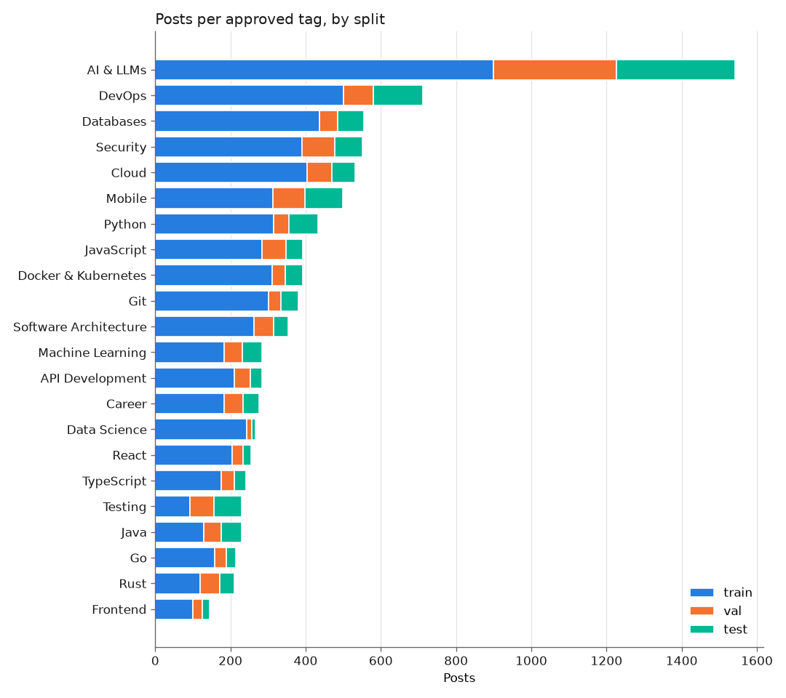
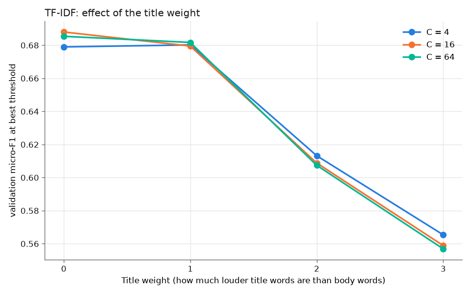
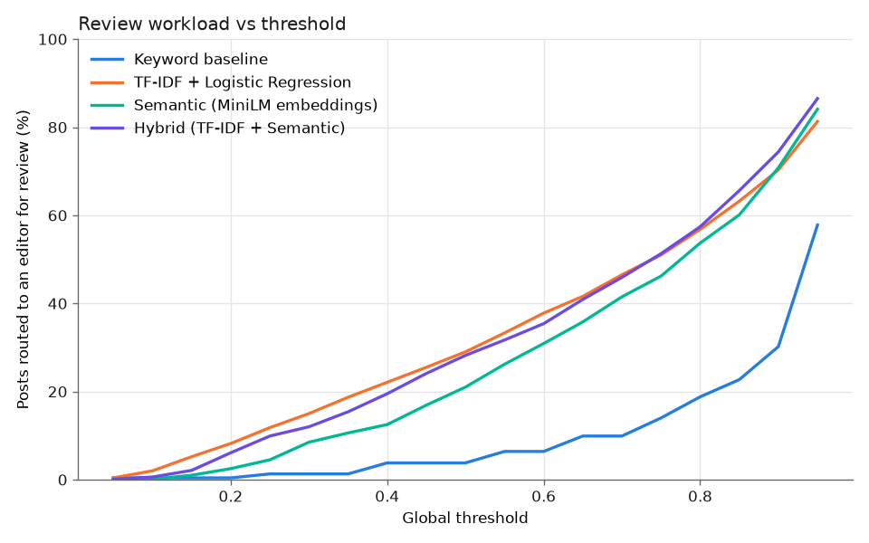
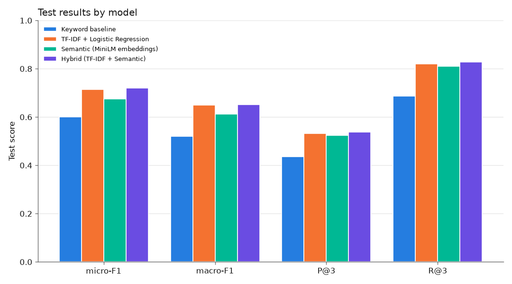

## Summary

Blog archives get harder to search when authors tag the same topic in different ways or leave posts
untagged. This project builds a multi-label system that reads a post's title and body (plain text,
Markdown or HTML), suggests up to five tags from a 22-tag approved taxonomy with a score for each, and
routes a post to an editor when it is empty, too short, or no tag is confident enough. Editors accept,
remove or add approved tags in a Streamlit app; their decisions are saved as feedback and can be
exported for a whole batch as CSV or JSON.

{{SUMMARY_RESULTS}}

| Deliverable | Where |
|---|---|
| Taxonomy, definitions, examples and alias map | `taxonomy/taxonomy.yaml` |
| Reproducible data preparation (dataset not redistributed) | `scripts/01_download_devto.py`, `scripts/02_prepare_data.py`, `data/article_ids.csv` |
| Training and evaluation code: keyword, TF-IDF, semantic | `tagger/models/`, `scripts/03_train.py` to `scripts/06_audit.py` |
| Working demo with CSV/JSON export | {{LIVE_URL}} · `streamlit_app.py` |
| Source code | {{REPO_URL}} |

## 1. Data

**Source.** 4,705 posts from the public DEV.to API (no key, no payment), published between
14 November 2025 and 14 November 2026. Posts were collected as the most popular posts of the past year for 29 seed tags,
two pages each, at about one request per second with every post cached to disk so the download
can resume. Each post keeps its title, Markdown body, the author's tags, publication date and URL.

**Copyright.** Article text belongs to its authors, so it is not redistributed. The repository
contains the download script and `data/article_ids.csv`, which lists every post used; running
the commands in the README rebuilds the same dataset.

**Labels.** The labels are the authors' own tags, mapped onto the approved taxonomy. DEV.to allows
at most four tags per post, and authors often spend slots on generic tags, so labels are
incomplete. Section 7 measures how much this matters.

## 2. Taxonomy and alias map

The taxonomy (`taxonomy/taxonomy.yaml`) has **22 approved tags**. Each tag has a definition, two
example titles, **aliases** (raw author tags that merge into it) and **keywords** for the baseline
model. The alias map merges variants into one editorial tag, for example:

| Raw author tags | Approved tag |
|---|---|
| `ml`, `machinelearning`, `deeplearning`, `pytorch`, `mlops` | Machine Learning |
| `ai`, `llm`, `agents`, `rag`, `mcp`, `openai`, `claude` | AI & LLMs |
| `security`, `cybersecurity`, `infosec`, `appsec`, `owasp` | Security |
| `docker`, `kubernetes`, `k8s`, `containers`, `helm` | Docker & Kubernetes |
| `react`, `nextjs`, `redux` | React |

Each alias belongs to exactly one tag (checked by a test). Tags that describe format or are used on
posts about everything (`programming`, `beginners`, `tutorial`, `discuss`, `webdev`, `opensource`,
`productivity` and others) are listed under `dropped_generic` and not mapped. Generic tags are common: 62.4% of posts (2,936 of 4,705) used at least one of their four tag slots on one, led by `webdev` (828 posts), `programming` (688) and `opensource` (500).
Keywords written in capitals (`AI`, `Rust`, `in Go`) match case-sensitively, so ordinary words
like "said", "rust" or "go to" do not trigger a tag.

**Tag counts.** After mapping, every post has at least one approved tag (1.91 on average: 1,501 posts have one, 2,256 two, 831 three and 117 four). The largest tag is AI & LLMs (1,541 posts) and the smallest Frontend (145). Tags are flagged as too few for reliable evaluation when they have fewer than 20 test posts or 80 in total: only **Data Science** is flagged, with 10 test and 12 validation posts, because few recent posts use it. Its test scores should be read with care.


*Posts per approved tag in each split (`reports/tag_counts.csv`).*

## 3. Cleaning, duplicates and the split

**Cleaning** (`tagger/cleaning.py`) detects whether the input is HTML, Markdown or plain text.
HTML navigation, headers, footers, sidebars, forms, scripts and buttons are removed with
BeautifulSoup. DEV.to liquid embeds, images, bare URLs and Markdown syntax are removed while link
text is kept. Short boilerplate lines ("follow me", "subscribe", "originally published at",
"thanks for reading"), lines that only list social sites, and **tag-widget lines** such as
`#python #ai` are dropped, because those would hand the label to the model. Code blocks keep
their language name and first 30 lines: code carries topic signal, but long listings drown out
the prose. Titles are only whitespace-normalised.

**Duplicates.** Before splitting, posts are joined into groups when they share a normalised title,
the same original (canonical) URL, or have TF-IDF cosine similarity of 0.90 or more. This found 12 groups containing 29 posts (16 links by identical title, 12 by near-identical body, none by canonical URL), mostly the same article posted twice by its author, sometimes in a second language.
A group always stays in one split, so a republished copy cannot leak from training into test.

**Split by date.** Groups are ordered by their earliest publication date. The oldest 70% of posts
form the training set, the next 15% the validation set and the newest 15% the test set, which
approximates how the system will meet new drafts.

| Split | Posts | Share | Published |
|---|---|---|---|
| Train | 3,294 | 70.0% | 14 Nov 2025 – 9 Jun 2026 |
| Validation | 706 | 15.0% | 9 Jun 2026 – 7 Sep 2026 |
| Test | 705 | 15.0% | 4 Sep 2026 – 14 Nov 2026 |

The boundaries overlap by a few days because whole duplicate groups are placed by their earliest post.

## 4. Models

All models share one interface: given titles and bodies, return a score between 0 and 1 for each
of the 22 tags. The same suggestion logic (`tagger/suggest.py`) is then applied to every model.

1. **Keyword baseline.** For each tag, count taxonomy keyword matches: each distinct keyword in the
   title counts 3, each occurrence in the body counts 1 (capped at 10), and the total *h* becomes
   a score of 1 − e^(−h/4). No training.
2. **TF-IDF + one-vs-rest logistic regression.** Separate TF-IDF vectorisers for the title
   (20k features) and the body (50k features), unigrams and bigrams, sublinear term frequency.
   The title block is multiplied by a **title weight**; one logistic regression per tag is trained
   on the combined features.
3. **Semantic model.** The pretrained sentence embedding model `all-MiniLM-L6-v2` (Sentence
   Transformers, 384 dimensions) encodes the title and the body. The body is split into chunks
   of about 150 words; long posts keep at most 8 chunks spread evenly from start to end, so a long
   article is represented across its whole length. Chunk vectors are combined by pooling (compared
   below), and one logistic regression per tag is trained on the result.
4. **Hybrid.** A weighted average of the TF-IDF and semantic scores.

### Validation experiments

Every choice below was made on the validation set; the test set was not used until Section 6.

{{TITLE_WEIGHT_TEXT}}


*TF-IDF validation micro-F1 by title weight and regularisation C.*

{{POOLING_TEXT}}


*Semantic model validation micro-F1 by chunk pooling.*

{{HYBRID_TEXT}}

## 5. Thresholds and the review workflow

Each model's scores become suggestions with two settings chosen on validation: a **score
threshold** (0.05 to 0.95 in steps of 0.05) and a **maximum number of tags** (1 to 5), keeping the
pair with the best micro-F1. Tags with at least 20 validation examples were also given their own
threshold; per-tag thresholds were kept only where they raised validation micro-F1.

A post is **routed to review** when it is empty, has fewer than 30 words after cleaning, or no tag
passes its threshold. The editor always sees the top five candidates with their scores, even when
none passes.

{{THRESHOLD_TABLE}}

{{THRESHOLD_TEXT}}


*Precision, recall and F1 of the default model on validation as the threshold changes.*


*Share of validation posts routed to review at each threshold, per model.*

## 6. Results on unseen posts

All models were evaluated once, with their tuned settings, on the test set (the newest 15% of
posts, never seen in training or tuning). Micro-F1 pools every tag decision; macro-F1 averages
per-tag F1 so rare tags count equally; P@3 and R@3 look only at the top three ranked tags; review
coverage is the share of posts tagged without an editor; speed is the median time to tag one post,
including cleaning, on a laptop CPU.

{{TEST_TABLE}}


*Test-set comparison of the four models.*

{{BEST_MODEL_TEXT}}

### By tag frequency

Tags were split into thirds by how many training posts they have.

{{FREQ_TABLE}}

{{FREQ_TEXT}}

### Short drafts

To imitate early drafts, each test post was cut to its title plus the first 40 or 10 words of the
body.

{{SHORT_TABLE}}

{{SHORT_TEXT}}

## 7. Errors and incomplete labels

Examples come from `reports/error_examples.md` (titles and links only).

{{ERRORS_TEXT}}

### The effect of incomplete historical labels

{{AUDIT_TEXT}}

## 8. The editor prototype

The Streamlit app (`streamlit_app.py`, live at {{LIVE_URL}}) has three pages.

- **Tag a draft.** Paste or upload a title and body as text, Markdown or HTML. The app shows the
  ranked candidates as score bars with a tick at each tag's threshold (bars past the tick are
  suggested), the review flag with its reason, and the cleaned text the model saw. The editor ticks
  or unticks tags, adds missing ones from the approved list only, and saves the decision to
  `feedback/feedback.jsonl`, which can be downloaded as CSV or JSON.
- **Batch review.** Tag ten bundled demo drafts, an uploaded CSV, or the latest DEV.to posts; edit
  the final tags in a table; export `post_id, title, model, suggested_tags, scores, review_status,
  review_reason, final_tags, editor_changed, reviewed_at` as CSV or JSON.
- **How it works.** Test results, threshold charts and a searchable view of the taxonomy.

**Supporting snippets.** Under each tag the app shows one sentence from the post: the sentence
with the most matches of that tag's taxonomy keywords, earliest first on ties, cut to 240
characters. No sentence is shown when no keyword appears. The rule is simple enough for an editor
to check.

{{APP_FIGURES}}

## 9. Success criteria

| Criterion | Evidence |
|---|---|
| Pipeline reproducible from documented commands | README "Commands, in order"; seeds fixed; versions pinned in `requirements.txt` |
| Only approved tags; empty and very short drafts go to review | Models only output the 22 taxonomy columns; editor additions are limited to the taxonomy; `tests/test_suggest.py`, `tests/test_engine.py` |
| Evaluation names the best balance of quality, coverage and speed, with error examples and the effect of incomplete labels | Sections 6 and 7; `reports/test_results.md`, `reports/error_examples.md`, `reports/audit/` |
| An editor can review suggestions and export a batch | Batch review page; sample export in the submission folder |

## 10. Limitations and next steps

- Labels are the authors' own tags: at most four per post and often generic, so measured precision
  understates real quality (Section 7). More editor-checked labels would give a fairer test set.
- {{LIMIT_RARE}}
- The semantic model is a small general-purpose encoder; fine-tuning it on tagged posts, or a
  larger encoder, may help similar-tag confusions.
- Feedback on the free host is stored on a temporary disk; a real deployment would write it to a
  database and use it for periodic retraining and evaluation on editor decisions.

## Reproducing the results

```
python -m pip install -r requirements.txt
python scripts/01_download_devto.py        # ~1.5 h, resumable
python scripts/02_prepare_data.py
python scripts/03_train.py
python scripts/04_tune_thresholds.py
python scripts/05_evaluate.py
python scripts/06_audit.py --score        # uses the reviewed reports/audit/audit_sample.csv
python -m pytest -q
streamlit run streamlit_app.py
```
